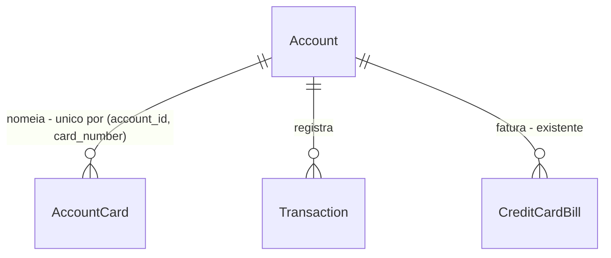

# Fatura do cartão por cartão

> Build this with **tlc-implement** (`.cursor/skills/tlc-implement/SKILL.md`).
> Every criterion below becomes a check with a proof, referenced by its number. Nothing under
> `Unresolved` gets settled while building.

## Intent

Na página da conta de cartão, a fatura aberta é uma lista única. Um gasto feito no cartão adicional ou no virtual entra nessa lista e no Total da fatura, e a tela não diz qual cartão o fez. Quem quer saber o que o dependente gastou tem de adivinhar pela descrição. A Pluggy já manda esse número em `creditCardMetadata.cardNumber` — “can be different from the account if it's done by an additional or virtual card” — e o sync guarda o payload em `transactions.raw_data`, sem mostrar o campo. Mesmo mostrando, `•••• 0597` não diz de quem é o cartão: isso só o dono da conta sabe.

Na página da conta com `type` `credit_card`, cada lançamento da fatura aberta mostra o cartão que o fez, a fatura se parte por cartão com subtotal que soma o Total da fatura, e cada cartão pode receber um nome que a pessoa cadastra e que passa a aparecer no lugar dos dígitos.

24 critérios em 3 fatias · 4 portas sem volta · 1 aberta, que não bloqueia

## Criteria

### Identidade do cartão

1. Dado um lançamento cujo `raw_data.creditCardMetadata.cardNumber` é `0597`, quando se lê o lançamento, então `card_number` é `0597` em `GET /api/transactions` e em `GET /api/transactions/{transaction_id}`.
2. Quando `creditCardMetadata` falta, é `null`, ou `cardNumber` falta ou é `""`, então `card_number` é `null` nas duas leituras. Um valor `0597` conserva o zero à esquerda.
3. Dado o lançamento do critério 1 numa conta `credit_card`, quando a fatura que o contém está aberta na página da conta, então a linha mostra `•••• 0597` na tabela e na lista mobile — os 4 últimos caracteres de `card_number`, no formato que `formatAccountMask` já usa.
4. Dado um lançamento com `card_number` `null` na mesma página, quando a fatura está aberta, então a linha não mostra máscara de cartão.
5. Numa conta cujo `type` não é `credit_card`, a página não mostra máscara de cartão nem grupos de cartão.

### Fatura por cartão

6. Dado uma conta `credit_card` com `masked_number` `1234`, moeda `BRL`, e a fatura aberta com estes lançamentos na moeda da conta: débito `100.00` posted `card_number` `1234`; débito `40.00` posted `0597`; crédito `10.00` posted `0597` fora de categoria `treat_as_transfer`; débito `25.00` posted `0597` com `is_ignored`; crédito `80.00` posted com `transfer_pair_id` preenchido; débito `5.00` pending com `card_number` `null`. Quando a fatura está aberta em pt-BR, os grupos e subtotais são `•••• 1234` = `100.00`, `•••• 0597` = `30.00`, `Sem cartão` = `5.00`, e a soma `135.00` é o Total da fatura na tela. Em en, o terceiro título é `No card`. O ignorado e o pagamento com par continuam na lista, no grupo do seu `card_number` ou em `Sem cartão`, e ficam de fora dos subtotais — o filtro da fatura é o mesmo de `counts_on_bill`, e o pending entra porque o Total da fatura é `projected_expenses`. Dois lançamentos com o mesmo `card_number` formam um grupo só.
7. Na fatura do critério 6, a ordem dos grupos é o `card_number` igual a `account.masked_number`, depois os demais `card_number` em ordem lexicográfica crescente, depois `Sem cartão`. Se `masked_number` é `null`, a ordem começa direto pelos `card_number`. Dentro de cada grupo, as linhas ficam na ordem relativa que a lista da fatura já usa.
8. Enquanto a fatura tem zero ou um balde — um único `card_number`, ou só lançamentos sem cartão — a quebra por cartão não aparece. A lista segue como hoje. Com a lista vazia, o texto permanece `Nenhuma transação para esta conta` em pt-BR e `No transactions for this account` em en.
9. Dado um lançamento ligado à fatura A com `card_number` `0597`, quando a página mostra a fatura B, então esse lançamento não entra em grupo nenhum da fatura B.
10. Enquanto a lista de lançamentos da fatura está carregando, a quebra por cartão não aparece e a lista mostra os 5 skeletons que já mostra.
11. Dado 500 débitos posted de `1.00` com `card_number` `1234` e 1 débito posted de `1.00` com `card_number` `0597` na mesma fatura, quando ela está aberta, então os subtotais são `500.00` e `1.00` e o Total da fatura é `501.00`. O `limit` `500` da lista não derruba o lançamento que passa dele.
12. Dado uma conta em `USD` com primária `BRL`, débito `10.00` `1234` e débito `5.00` `0597`, quando o seletor de moeda da conta estrangeira está na moeda da conta, os subtotais são `10.00` e `5.00` em `USD` e somam o Total da fatura. Quando o seletor está na moeda primária, os subtotais estão em `BRL` e a soma deles é o Total da fatura mostrado na tela.

### Nome do cartão

13. Dado a conta do critério 6, quando se chama `GET /api/accounts/{account_id}/cards`, então a resposta é `200` com um item por `card_number` distinto que aparece nos lançamentos da conta — `1234` e `0597`, cada um com `name` — na ordem do critério 7. Lançamentos sem `card_number` não geram item.
14. Quando se chama `PUT /api/accounts/{account_id}/cards/0597` com `{"name": "Amanda"}`, então a resposta é `200` com `card_number` `0597` e `name` `Amanda`, e o grupo daquele cartão na fatura passa a mostrar `Amanda •••• 0597` no lugar de `•••• 0597`. As linhas dentro do grupo continuam mostrando só `•••• 0597`.
15. Dado o cartão `0597` com nome `Amanda`, quando se chama o mesmo `PUT` com `{"name": ""}` ou `{"name": "   "}`, então a resposta é `200` com `name` `null`, o item segue em `GET /api/accounts/{account_id}/cards` com `name` `null`, e o grupo na fatura volta a `•••• 0597`.
16. Quando o `PUT` recebe `name` com 256 caracteres, então a resposta é `422` e nenhum nome é gravado. Com `  Amanda  `, o `name` gravado e devolvido é `Amanda`.
17. Quando o `PUT` usa um `card_number` que não aparece em nenhum lançamento daquela conta, então a resposta é `404` e nada é gravado.
18. Dado uma conta de outro workspace, quando se chama o `GET` ou o `PUT` daquela conta, então a resposta é `404`.
19. Dado um membro sem permissão de escrita no workspace, quando ele chama o `PUT`, então a resposta é `403` e nada é gravado; o `GET` responde `200`. A página não oferece o campo de nome quando `canWrite` é falso.
20. Quando o mesmo `PUT` com `{"name": "Amanda"}` é chamado duas vezes, então as duas respostas são `200` com `name` `Amanda` e existe exatamente uma linha em `account_cards` para aquele `(account_id, card_number)`.
21. Quando dois `PUT` para o mesmo `(account_id, card_number)` chegam ao mesmo tempo com `Amanda` e `Bruno`, então nenhum responde `500`, existe exatamente uma linha em `account_cards` para esse par, e o `name` nela é o de um dos dois — o último a gravar vence. A unicidade de `(account_id, card_number)` é o que garante a linha única.
22. Quando a conta é apagada, então as linhas de `account_cards` daquela conta somem com ela, pela cascata do `account_id`. Um `card_number` que deixa de aparecer nos lançamentos conserva a sua linha, e volta a aparecer com o nome quando o cartão voltar à fatura.
23. Sempre, uma sincronização não altera nem apaga um nome de cartão: o sync escreve em `transactions`, `accounts` e `credit_card_bills`, e nenhum caminho dele escreve em `account_cards`.
24. Enquanto a lista de cartões está carregando na tela que cadastra os nomes, nenhum campo de nome aparece. Quando a conta não tem nenhum `card_number` nos lançamentos, a tela diz que nenhum cartão foi visto ainda, em vez de uma lista vazia.

## Out of scope

- Papel do cartão — `titular`, `dependente`, `virtual`. A Pluggy manda os dígitos, não o papel, e cadastrar o nome já responde de quem é o cartão.
- Cadastrar um cartão que nunca apareceu num lançamento. O critério 17 recusa; a lista é o que a fatura viu.
- Limite, fatura ou vencimento por cartão. O limite continua da conta.
- Fundir contas distintas numa fatura. `shared_balance_group` agrupa produtos que repetem o mesmo saldo consolidado, como Visa e Mastercard da mesma linha, e o dashboard já usa isso para não contar a dívida duas vezes.
- Buscar de novo a Pluggy, inclusive `/bills/{billId}/transactions`. A tela lê o que o sync já gravou.
- Coluna nova no CSV de `GET /api/transactions/export`.
- Nome ou máscara de cartão na página de transações, no dashboard e nos relatórios.
- Mudar a regra do Total da fatura, do limite ou do vencimento.

## Observable

| Surface | Decision | Landing |
| --- | --- | --- |
| screen página da conta, fatura do cartão | empty state | 8 |
| screen página da conta, fatura do cartão | loading state | 10 |
| screen página da conta, fatura do cartão | error state | existing - a query de lançamentos não tem painel de erro; esta tarefa não acrescenta um |
| screen página da conta, fatura do cartão | unauthorised state | existing - rota protegida e `current_workspace` |
| screen página da conta, fatura do cartão | density and ordering | 7, 14 |
| screen página da conta, fatura do cartão | destructive action confirms | n/a - nenhuma ação destrutiva nova |
| screen cadastro de nomes dos cartões | empty state | 24 |
| screen cadastro de nomes dos cartões | loading state | 24 |
| screen cadastro de nomes dos cartões | error state | existing - `extractApiError` no toast, como as outras mutations da página |
| screen cadastro de nomes dos cartões | unauthorised state | 19 |
| screen cadastro de nomes dos cartões | density and ordering | 13 |
| screen cadastro de nomes dos cartões | destructive action confirms | n/a - apagar um nome é renomear para vazio e não apaga lançamento nenhum |
| API `GET /api/transactions` | response shape | 1, 2 |
| API `GET /api/transactions` | error shape and codes | existing - os códigos de hoje |
| API `GET /api/transactions` | who may call it | existing - `current_workspace` |
| API `GET /api/transactions` | versioning | n/a - campo aditivo, sem versão nova da rota |
| API `GET /api/transactions` | rate limit | n/a - sem limite novo |
| API `GET /api/transactions/{transaction_id}` | response shape | 1, 2 |
| API `GET /api/transactions/{transaction_id}` | error shape and codes | existing - os códigos de hoje |
| API `GET /api/transactions/{transaction_id}` | who may call it | existing - `current_workspace` |
| API `GET /api/transactions/{transaction_id}` | versioning | n/a - campo aditivo |
| API `GET /api/transactions/{transaction_id}` | rate limit | n/a - sem limite novo |
| API `GET /api/accounts/{account_id}/cards` | response shape | 13 |
| API `GET /api/accounts/{account_id}/cards` | error shape and codes | 18 |
| API `GET /api/accounts/{account_id}/cards` | who may call it | 18, 19 |
| API `GET /api/accounts/{account_id}/cards` | versioning | n/a - rota nova, sem consumidor externo |
| API `GET /api/accounts/{account_id}/cards` | rate limit | n/a - sem limite novo |
| API `PUT /api/accounts/{account_id}/cards/{card_number}` | response shape | 14, 15 |
| API `PUT /api/accounts/{account_id}/cards/{card_number}` | error shape and codes | 16, 17, 18, 19 |
| API `PUT /api/accounts/{account_id}/cards/{card_number}` | who may call it | 18, 19 |
| API `PUT /api/accounts/{account_id}/cards/{card_number}` | versioning | n/a - rota nova, sem consumidor externo |
| API `PUT /api/accounts/{account_id}/cards/{card_number}` | rate limit | n/a - sem limite novo |
| command | — | n/a - nenhum comando |
| document | — | n/a - nenhum documento |
| collection grupos da fatura | grouping criterion | 6 |
| collection grupos da fatura | naming | 3, 6, 14 |
| collection grupos da fatura | ordering | 7 |
| collection grupos da fatura | duplicates | 6 - o mesmo `card_number` é um grupo; dois plásticos com os mesmos 4 dígitos não se separam |
| collection grupos da fatura | exception that does not fit | 6 - lançamento sem `card_number` cai em `Sem cartão` |

## Swept

- validation: 2, 16
- failure modes: 6, 17
- idempotency and retry: 20
- authorization: 18, 19
- concurrency and ordering: 21
- data lifecycle: 22
- external-dependency failure: 23
- state transitions: n/a - nenhum ciclo de vida novo; um nome existe ou não existe
- observability: existing - as rotas novas entram no log de requisições que toda rota já tem, e não há job nem fila nova

## Impact

| Front | What changes |
|---|---|
| domain | new term: `card_number` - caracteres do cartão que fez o lançamento, vindos de `creditCardMetadata.cardNumber`, na leitura do lançamento. Não é um papel. |
| domain | new term: `AccountCard` - um cartão visto numa conta e o nome que a pessoa deu a ele, em `app.models`. Chaveado por `(account_id, card_number)`; não é uma conta e não tem saldo nem limite. |
| domain | existing term: `Account.masked_number` continua o número da própria conta, vindo de `account.number` na Pluggy, dono do provedor e não editável. Quem chama `formatAccountMask` continua lendo esse campo. Passa a ter um segundo papel: no critério 7 é ele que decide qual grupo vem primeiro. |
| domain | existing term: `shared_balance_group` continua a chave que impede uma linha de crédito consolidada de entrar duas vezes no patrimônio. O dashboard ramifica nele. Não passa a significar cartão adicional da mesma fatura. |
| stored data | tabela nova `account_cards`, vazia ao nascer. Nada para migrar: nenhum nome existe hoje, e o `card_number` já está em `transactions.raw_data` nos lançamentos que a Pluggy sincronizou. A unicidade nasce com a tabela, então não corre contra linhas que já existam. |

## Decided

| Decision | Shape | Alternative rejected |
|---|---|---|
| `card_number` na leitura do lançamento | `TransactionRead.card_number: string \| null`. O valor é `creditCardMetadata.cardNumber`; ausente, `null` ou `""` grava `null`. Guardado como texto, sem truncar — truncar juntaria dois cartões diferentes no mesmo balde. A tela mostra só os 4 últimos. | Ler o valor como inteiro — perderia o zero à esquerda de `0597`. |
| Tabela `account_cards` | `account_cards(id uuid pk, user_id uuid fk users.id, workspace_id uuid fk workspaces.id on delete cascade, account_id uuid fk accounts.id on delete cascade, card_number varchar(19) not null, name varchar(255) null, created_at, updated_at)`, com `UniqueConstraint("account_id", "card_number", name="uq_account_cards_account_card_number")`. Migração `097`, revisa `096`. | Uma coluna `card_name` em `transactions` — repetiria o nome em cada lançamento e renomear o cartão viraria um UPDATE em massa. |
| Um nome por cartão por conta | A unicidade de `(account_id, card_number)` decide o comportamento: o mesmo cartão não carrega dois nomes, e o `PUT` é upsert. Dois cartões podem ter o mesmo nome. | Unicidade por `(workspace_id, card_number)` — dois bancos distintos emitem cartões com os mesmos 4 dígitos, e isso faria um deles herdar o nome do outro. |
| Rotas de cartão aninhadas na conta | `GET /api/accounts/{account_id}/cards` → `[{card_number, name}]`; `PUT /api/accounts/{account_id}/cards/{card_number}` com `{"name": string}` → `{card_number, name}`. O aninhamento segue `GET /api/accounts/{account_id}/bills`. Escrita por `current_writable_workspace`, leitura por `current_workspace`. | `PATCH /api/accounts/{account_id}` com um mapa de nomes — misturaria a edição da conta com a dos cartões e tornaria a escrita de um nome dependente de reenviar o resto. |

## Relations

## Surface

| Route | In | Out | Status | Criteria |
|---|---|---|---|---|
| `GET /api/transactions` | inalterado | `items[].card_number` | `200`; erros inalterados | 1, 2 |
| `GET /api/transactions/{transaction_id}` | inalterado | `card_number` | `200`; erros inalterados | 1, 2 |
| `GET /api/accounts/{account_id}/cards` | `account_id` | `card_number`, `name` | `200`, `404` | 13, 18 |
| `PUT /api/accounts/{account_id}/cards/{card_number}` | `account_id`, `card_number`, `name` | `card_number`, `name` | `200`, `403`, `404`, `422` | 14, 15, 16, 17, 18, 19 |

## Sources

- Pedido neste chat: “poder visualizar os gastos do cartão de crédito dependente, e ter a visualização de toda a fatura (todos cartões de dependente, virtual etc)”. Sem documento além desta conversa.
- Respostas neste chat às perguntas abertas da primeira versão desta tarefa: “1 - Ter possibilidade de cadastrar o nome” e “2 - sim”, que decidem a fatia Nome do cartão e a ordem dos grupos do critério 7.
- [Transaction \| Pluggy Docs](https://docs.pluggy.ai/docs/transactions) — `creditCardMetadata.cardNumber`: “The credit Card Number associated with the transaction can be different from the account if it's done by an additional or virtual card.”

This task is the record of decision. If a linked document diverges, ask before building.

## Unresolved

| # | Kind | Question | Until answered |
|---|---|---|---|
| 1 | open | Onde se cadastra o nome do cartão: no `CreditCardSettingsDialog` que a página da conta já abre pelo lápis, ou renomeando direto no título do grupo da fatura? | Os critérios 13, 19 e 24 valem para o `CreditCardSettingsDialog`, que já é a configuração do cartão, já está atrás de `canWrite`, e é alcançável mesmo quando a fatura tem um cartão só e não mostra grupos (critério 8). Renomear no título do grupo não cobre esse caso. |
