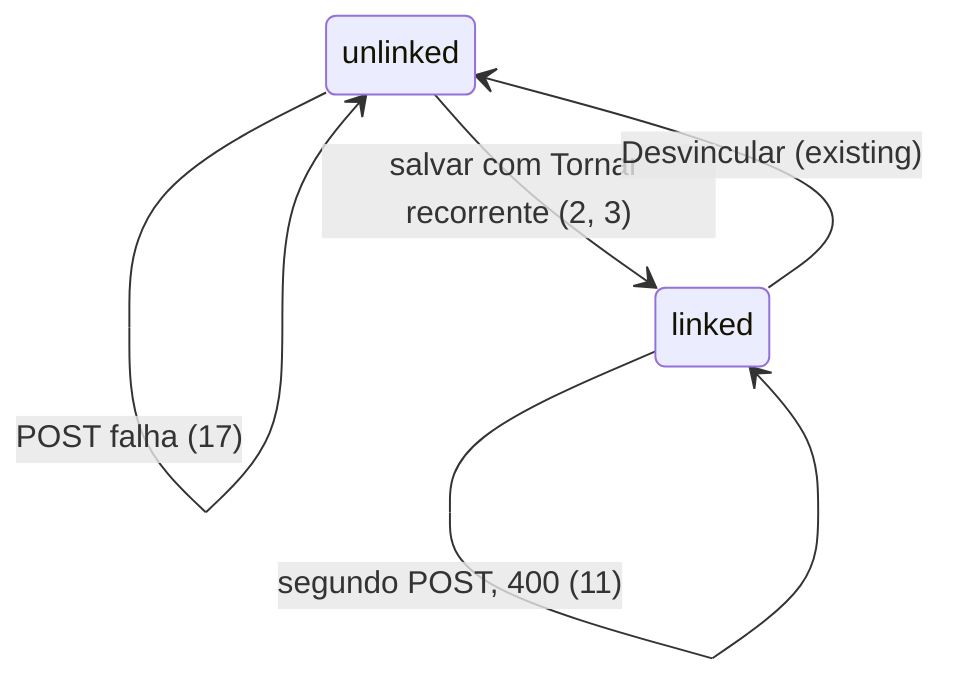

# Marcar transação como recorrente

> Build this with **tlc-implement** (`.cursor/skills/tlc-implement/SKILL.md`).
> Every criterion below becomes a check with a proof, referenced by its number. Nothing under
> `Unresolved` gets settled while building.

## Intent

Hoje "Tornar recorrente" só aparece ao criar uma transação manual. Uma compra que o cartão já sincronizou, ou qualquer lançamento já gravado, não pode ser declarada fixa. E, mesmo no criar, a recorrência nasce solta: a transação não recebe `recurring_transaction_id`, então a lista não mostra o badge `Recorrente` e o diálogo não diz que ela está vinculada. Quem reconhece o Netflix na fatura tem que recriar a regra na página de recorrentes, sem o dia do mês, e o lançamento que originou a regra continua mudo. A fonte não traz volume nem data.

No diálogo da transação — criar e editar, conta ou cartão, manual ou sincronizada — o mesmo checkbox `Tornar recorrente` grava uma `RecurringTransaction` já existente e vincula esta transação a ela. A frequência continua o conjunto que o diálogo já oferece; "todo dia X do mês" é o `day_of_month` que a página `/recurring` já tem. A transação mostra o badge, e a próxima ocorrência aparece na projeção que a conta e o calendário já leem.

17 critérios em 2 fatias · 1 porta sem volta · 1 aberta, que não bloqueia

## Criteria

### A transação fica recorrente

1. Dado uma transação sem `recurring_transaction_id`, sem `transfer_pair_id`, sem `installment_number` e sem `installment_series_id`, no diálogo de criação e no de edição (conta `checking`, `savings` ou `credit_card`, manual ou com `source` de sync), o checkbox `Tornar recorrente` (en: `Make recurring`) aparece desmarcado e a lista não mostra o badge `Recorrente` (en: `Recurring`).
2. Dado uma transação já gravada de conta `credit_card` sincronizada (`connection_id` preenchido), valor `49.90`, data `2026-10-07`, `status` `posted`, `bill_id` preenchido, quando o usuário marca `Tornar recorrente` com frequência `monthly` e salva, então `recurring_transaction_id` passa a apontar para a recorrência criada, a lista mostra o badge `Recorrente`, e ao reabrir o diálogo aparece `Esta transação está vinculada a uma conta recorrente.` (en: `This transaction is linked to a recurring bill.`) com o botão `Desvincular`. `date`, `amount`, `status`, `source` e `bill_id` da transação permanecem os de antes do save.
3. Dado o diálogo de criação de uma transação manual com o checkbox marcado e frequência `monthly`, quando o save conclui, a transação criada tem `recurring_transaction_id` preenchido e a lista mostra o badge `Recorrente`.
4. A `RecurringTransaction` criada no critério 2 ou 3 copia `description`, `amount`, `currency`, `type`, `account_id` e `category_id` da transação, com `start_date` igual à `date` dela, `frequency` a escolhida, `end_date` null quando o campo fica vazio e a data escolhida quando preenchido, `auto_generate` true, `is_active` true, `weekend_adjustment` `none`. `GET /api/recurring-transactions` devolve essa linha.
5. Dado data `2026-10-07` e frequência `weekly`, `next_occurrence` é `2026-10-14` e `day_of_month` é null.
6. Dado data `2026-10-07`, valor `49.90`, frequência `monthly` e dia do mês vazio, `next_occurrence` é `2026-11-07` e `day_of_month` é null. Continua existindo uma única transação nessa conta com essa descrição na data `2026-10-07`. `GET /api/dashboard/projected-transactions?account_id={id}&from=2026-10-01&to=2026-11-30` inclui um item com esse `recurring_id`, `date` `2026-11-07`, `description` e `amount` `49.90`, e não inclui data `2026-10-07` para esse `recurring_id`.
7. Dado data `2026-10-07`, frequência `monthly` e `day_of_month` `15`, `next_occurrence` é `2026-11-15` e `day_of_month` é `15`.
8. Dado data `2026-01-31`, frequência `monthly` e `day_of_month` `31`, `next_occurrence` é `2026-02-28` e `day_of_month` é `31`.
9. Dado data `2026-10-07`, frequência `quarterly` e dia do mês vazio, `next_occurrence` é `2027-01-07`.
10. Com o checkbox marcado, aparecem `Frequência` (as seis opções já do diálogo, nesta ordem: `Mensal`, `Trimestral`, `A cada 6 meses`, `Semanal`, `A cada 2 semanas`, `Anual`; en: `Monthly`, `Quarterly`, `Semiannual`, `Weekly`, `Biweekly`, `Yearly`), `Dia do mês` (en: `Day of month`) só quando a frequência é `monthly`, `quarterly`, `semiannual` ou `yearly`, e `Data de fim (opcional)` (en: `End date (optional)`). Em `weekly` e `biweekly` o dia do mês não aparece.

### Recusas

11. Dado uma transação que já tem `recurring_transaction_id`, o checkbox não aparece. `POST /api/transactions/{id}/make-recurring` devolve `400` com `detail` `Transaction is already linked to a recurring bill`, e a contagem de `RecurringTransaction` dessa descrição e `start_date` continua `1`.
12. Dado uma transação com `transfer_pair_id` preenchido, o checkbox não aparece. O mesmo POST devolve `400` com `detail` `A transfer cannot be marked recurring` e não cria `RecurringTransaction`.
13. Dado uma transação com `installment_number` preenchido ou `installment_series_id` preenchido, o checkbox não aparece. O mesmo POST devolve `400` com `detail` `An installment cannot be marked recurring` e não cria `RecurringTransaction`.
14. `frequency` fora de `weekly`, `biweekly`, `monthly`, `quarterly`, `semiannual`, `yearly`, ou `day_of_month` fora de `1`–`31`, ou `day_of_month` enviado com `weekly` ou `biweekly`, devolve `422` e não cria `RecurringTransaction`.
15. `POST /api/transactions/{id}/make-recurring` com id ausente neste workspace devolve `404` com `detail` `Transaction not found`.
16. Um membro com papel de leitura recebe `403` com `detail` `Read-only role` e nenhuma `RecurringTransaction` é criada.
17. Se o vínculo não puder ser gravado, não resta linha em `recurring_transactions` para essa tentativa e `recurring_transaction_id` continua null. Num `400` do POST, o toast mostra esse `detail` e o badge `Recorrente` não aparece.

## States

## Out of scope

- Transferência com as duas pernas recorrendo juntas — `RecurringTransaction` tem um `account_id` e `generate_pending` grava uma `Transaction`. O default até a pergunta 1 fechar é o critério 12.
- Editar frequência, valor ou dia a partir da transação já vinculada — a página `/recurring` já edita a regra; o diálogo continua só desvinculando.
- Ajuste de fim de semana no diálogo da transação — continua só em `/recurring`; aqui `weekend_adjustment` fica `none`.
- Incluir a recorrência em `GET /api/accounts/{id}/upcoming-bills` ("Próximas faturas") — a ocorrência futura entra na projeção que a lista da conta e o calendário já leem (`next_occurrence`).
- Mudar `generate_pending`: conta sincronizada segue com placeholder `pending`, conta manual com `posted`, e um lançamento real já existente na ocorrência é vinculado em vez de duplicado.
- Copiar `payee`, `notes` ou splits para a recorrência — `RecurringTransaction` não tem esses campos, e as ocorrências geradas continuam levando só o que a geração já copia.
- Uma entidade ou rótulo novo "fixa" — o nome na interface continua `Tornar recorrente` / `Recorrente`.
- Alterar `uq_recurring_tx` (`user_id`, `description`, `frequency`, `start_date`).

## Observable

| Surface | Decision | Landing |
| --- | --- | --- |
| screen diálogo da transação | empty state | 1 |
| screen diálogo da transação | loading | existing — Salvar fica desabilitado enquanto `loading` |
| screen diálogo da transação | error state | 17 |
| screen diálogo da transação | unauthorised | existing — com `canWrite` falso o diálogo de edição não abre; a rota é o critério 16 |
| screen diálogo da transação | density and ordering | 10 |
| screen diálogo da transação | destructive action confirms | n/a — marcar não destrói; Desvincular já existe e não pede confirmação |
| screen lista de transações | empty state | 1 — sem vínculo, sem badge |
| screen lista de transações | ordering | n/a — a ordem da lista não muda |
| screen `/recurring` | empty state | existing — a linha nova é uma `RecurringTransaction` comum (4) |
| API `POST /api/transactions/{id}/make-recurring` | response shape | 2, 4 — `201` e `TransactionRead` com `recurring_transaction_id` |
| API `POST /api/transactions/{id}/make-recurring` | error shape and codes | 11, 12, 13, 14, 15, 16 |
| API `POST /api/transactions/{id}/make-recurring` | who may call | 16 |
| API `POST /api/transactions/{id}/make-recurring` | versioning | n/a — a API não é versionada |
| API `POST /api/transactions/{id}/make-recurring` | rate limit | n/a — as rotas de transação não têm limite de taxa |
| API `GET /api/dashboard/projected-transactions` | response shape | existing — o critério 6 lê o contrato que já existe |

## Swept

- validation: 14
- failure modes: 17
- idempotency and retry: 11
- authorization: 16 — `current_writable_workspace` já responde `403` `Read-only role`
- concurrency and ordering: n/a — dois POST paralelos na mesma transação caem no `uq_recurring_tx` que já existe e hoje não é traduzido; esta tarefa não adiciona trava
- data lifecycle: existing — Desvincular zera só o FK; apagar a `RecurringTransaction` faz `ON DELETE SET NULL`. Nada é backfill
- external-dependency failure: existing — `stamp_primary_amount` já deixa `amount_primary` null quando não há taxa e ainda grava a linha
- state transitions: 2, 3, 11, 17
- observability: n/a — criar recorrência hoje não emite métrica; esta tarefa também não

## Impact

| Front | What changes |
|---|---|
| domain | existing term: `RecurringTransaction` continua sendo a regra que projeta e, com `auto_generate`, materializa ocorrências. Quem já ramifica: `generate_pending`, o match no sync (`find_bill_for_incoming` / `find_real_tx_for_occurrence`), a projeção do dashboard e do calendário, o badge e o Desvincular. |
| domain | existing term: `transactions.recurring_transaction_id` continua significando "esta linha cumpre esta regra". Passa a ser preenchido também na transação que o usuário marcou, não só em placeholder e em match posterior. O match procura lançamento com o FK null, então a linha de origem não é candidata de uma ocorrência futura. A projeção começa em `next_occurrence`, então a data de origem não é desenhada de novo. |
| stored data | nada a migrar — a linha em `recurring_transactions` e o FK nascem no momento em que o usuário marca |

## Decided

| Decision | Shape | Alternative rejected |
|---|---|---|
| A regra é uma `RecurringTransaction`; o vínculo é `transactions.recurring_transaction_id` | sem tabela nova | uma entidade "fixa" ao lado — duplicaria frequência, `day_of_month`, geração e match, e o badge deixaria de ler o FK que já existe |
| `POST /api/transactions/{transaction_id}/make-recurring` | body `frequency`, `day_of_month` opcional, `end_date` opcional; `201` `TransactionRead` | `POST /api/recurring-transactions` e um segundo pedido para gravar o FK — o primeiro commit pode ficar sem vínculo, que é o furo do criar de hoje |

## Surface

| Route | In | Out | Status | Criteria |
|---|---|---|---|---|
| `POST /api/transactions/{transaction_id}/make-recurring` | `frequency`, `day_of_month`, `end_date` | `TransactionRead` (`recurring_transaction_id`) | `201`, `400`, `403`, `404`, `422` | 2, 4, 11–17 |

## Sources

- Conversa de 2026-10-07 — a fonte não tem outro endereço. O trecho que esta tarefa não pode errar: "poder dizer que uma transação (cartão de crédito, conta, transferencia etc) é uma transação fixa ( a cada mes, semana, todo dia x do mês)". "Fixa" na interface continua `Tornar recorrente`. "A cada mês" é `monthly` usando o dia da transação quando `day_of_month` vem vazio; "todo dia x" é `day_of_month` `1`–`31`; "semana" é `weekly`.

This task is the record of decision. If a linked document diverges, ask before building.

## Unresolved

| # | Kind | Question | Until answered |
|---|---|---|---|
| 1 | open | Uma transferência marcada como fixa deve passar a recorrir nas duas pernas (débito numa conta e crédito na outra), ou fica de fora desta tarefa? | O critério 12 esconde o checkbox e o POST devolve `400` `A transfer cannot be marked recurring`. Se a resposta for as duas pernas, o critério 12 sai e isso vira outra tarefa: a regra de hoje tem um `account_id` só. |
