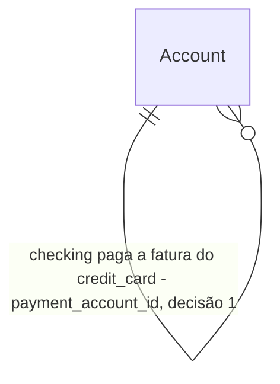

# Saldo da conta em cada dia do mês

> Build this with **tlc-implement** (`.cursor/skills/tlc-implement/SKILL.md`).
> Every criterion below becomes a check with a proof, referenced by its number. Nothing under
> `Unresolved` gets settled while building.

## Intent

Quem abre o calendário vê um único `ending_balance` por dia, misturando o que já está na conta com o que ainda vai acontecer, e a fatura do cartão não sai da conta corrente no vencimento. Não dá para ler quanto está na conta agora e quanto fica em cada dia seguinte depois de todas as transações já lançadas.

No calendário de transações (`/transactions?view=calendar`), a conta mostra o saldo real (lançamentos `posted` até hoje) e, no dia de hoje e em cada dia futuro, o saldo previsto. O previsto parte do saldo real e aplica cada transação na data dela: débito, crédito, transferência, pendente, futura e recorrência. A fatura de cada cartão ligado à conta entra no vencimento, uma vez, pelo valor total. Gasto que ainda não existe não é inventado. O cartão aponta para a conta corrente desde o cadastro.

15 critérios em 3 fatias · 1 porta sem volta · 1 aberta, não bloqueia

## Criteria

### A conta corrente do cartão

1. Dado uma conta `checking` chamada `Conta`, quando se cria um cartão sem `payment_account_id`, então `POST /api/accounts` responde `422` e nenhuma conta nova é gravada.
2. Quando o cartão é criado com `payment_account_id` da `Conta`, então a resposta é `201` e o `GET` seguinte devolve esse `payment_account_id`.
3. Quando `payment_account_id` aponta para uma conta `savings`, outro `credit_card`, uma conta fechada, ou uma conta de outro workspace, então a resposta é `422` nos três primeiros casos e `404` no workspace alheio, e o cartão não é gravado.
4. Um cartão que já existe, inclusive um que o sync criou, pode ter `payment_account_id` `null`. `PATCH /api/accounts/{id}` com a `Conta` grava o vínculo e o `GET` devolve. Enquanto está `null`, o calendário da `Conta` não se move por causa desse cartão.

### Saldo real e saldo previsto

5. Dado a `Conta` com saldo real `1000.00` `BRL` (só lançamentos `posted` com data até hoje) e nenhuma outra movimentação, três dias futuros consecutivos `T`, `C` e `X` dentro do mês pedido: um débito `pending` de `80.00` em `T` com descrição `Mercado`, um crédito `posted` de `200.00` em `C` com descrição `Salário`, e uma transferência `pending` de `40.00` em `X` da `Conta` para outra conta corrente. Quando se chama `GET /api/transactions/calendar?month=` o mês de `T` `&account_id=` a `Conta`, então `actual_balance` é `1000.00`. Todo dia da grade anterior a `T` tem `ending_balance` `1000.00`; de `T` até o dia anterior a `C`, `920.00`; de `C` até o dia anterior a `X`, `1120.00`; de `X` em diante, `1080.00`. `T` lista o `Mercado` com `kind` `projected`, `id` da transação, `type` `debit`, `amount` `80.00`. `C` lista o `Salário` com `kind` `projected`, `id` da transação, `type` `credit`, `amount` `200.00`. `X` lista a transferência, `is_transfer` verdadeiro, e o saldo cai `40.00`, não `80.00`. Nenhum dos três muda `actual_balance`.
6. Dado a `Conta` com saldo real `1000.00`, uma recorrência de débito `300.00` descrição `Aluguel` num dia futuro `R` do mês, e três débitos `posted` de `30.00` em datas passadas, já dentro dos `1000.00`, sem recorrência: então `actual_balance` continua `1000.00`, `ending_balance` é `700.00` de `R` em diante, e um dia futuro sem transação repete o `ending_balance` do dia anterior. Os três `30.00` aparecem na data deles com `kind` `actual` quando essa data está na grade, e não geram um quarto débito no futuro.
7. Dado a `Conta` com saldo real `1000.00` `BRL` e nenhuma outra movimentação, um cartão `Nubank` com `payment_account_id` da `Conta`, `statement_close_day` e `payment_due_day` preenchidos, e um débito de `250.00` no cartão dentro do ciclo cujo vencimento `D` é amanhã ou depois e cai no mês pedido, sem linha em `credit_card_bills` e sem pagamento agendado na `Conta`: então `actual_balance` é `1000.00`, todo dia da grade anterior a `D` tem `ending_balance` `1000.00`, e `D` e cada dia posterior têm `750.00`. `D` tem um item `kind` `projected`, `id` `null`, `recurring_id` `null`, `type` `debit`, `amount` `250.00`, `currency` `BRL`, `description` `Nubank`, `account_id` da `Conta`, `projected_expense` `250.00`, `projected_count` `1`. O débito do cartão não aparece na `Conta` na data da compra.
8. Dado uma `credit_card_bills` desse cartão com `due_date` `D` e `total_amount` `400.00`, e o débito de `250.00` do mesmo ciclo: então `D` derruba a `Conta` em `400.00` uma vez só. A linha da fatura é o total; os lançamentos do ciclo não somam por cima.
9. Dado uma transferência `pending` de `250.00` na `Conta` no dia `D`, com par no `Nubank`: então o `ending_balance` de `D` em diante é `750.00`, não `500.00`. O dia tem a transferência e não tem um segundo item de `250.00` pela fatura. O pagamento agendado já é a saída; a projeção não soma a fatura de novo.
10. Dado uma segunda conta corrente `Outra` com saldo real `1000.00`: então o calendário da `Outra` fica com `actual_balance` `1000.00` e `ending_balance` `1000.00` todos os dias. A fatura só sai da conta apontada por `payment_account_id`.
11. Dado o mês seguinte, cuja grade começa depois de `D`: então nenhum dia lista o item da fatura, `actual_balance` da `Conta` é `1000.00`, e todo `ending_balance` da `Conta` nessa grade é `750.00`. O valor entra na semente, como uma recorrência anterior à grade.
12. Dado a fatura com `due_date` hoje ou anterior: então `actual_balance` não muda por causa dela e nenhum dia futuro muda o `ending_balance` por causa dela. Vencida não é movida para hoje.
13. Sem `account_id`, `actual_balance` é a soma dos saldos `posted` das contas `checking` abertas, e o `ending_balance` de cada dia é essa soma caminhada com todas as transações dessas contas na data de cada uma, mais a fatura do critério 7 derrubando `250.00` em `D`. O saldo do cartão não entra. Uma conta `savings` também não entra nessa soma. Com `account_id` da `Conta`, vale o critério 7.
14. Dado a `Conta` em `BRL`, o cartão em `USD` e um `FxRate` `USD`→`BRL` com `rate` `5` hoje, fatura de `100.00` `USD` em `D`: então o item mostra `amount` `100.00` `currency` `USD` e `amount_primary` `500.00`, `actual_balance` não converte a fatura, e o `ending_balance` da `Conta` cai `500.00` a partir de `D`. A conversão é a de `fx_convert`.

### A tela

15. No diálogo de criar conta, com tipo cartão, um seletor `Conta que paga a fatura` (en: `Account that pays the bill`) lista as contas `checking` pelo nome e impede criar sem uma. Nas configurações de um cartão já existente, o mesmo seletor grava o `PATCH` do critério 4 e pode ficar vazio. Em `/transactions?view=calendar` com a `Conta` selecionada, a vista mostra `Saldo real` (en: `Actual balance`) `1000.00`. Cada dia de hoje em diante mostra `Saldo previsto` (en: `Projected balance`) com o `ending_balance` desse dia. O dia `D` mostra `Nubank` e `250.00` na linha tracejada de projetado. A linha não abre transação.

## Out of scope

- Gravar a fatura do cartão como lançamento na conta corrente — o item existe só na leitura do calendário.
- Abrir o cartão ao clicar na linha.
- Projetar gasto pelo histórico ou por orçamento. Os três débitos passados do critério 6 não criam débito futuro; recorrência continua na data dela.
- Marcar recorrência como dispensável.
- Ligar uma fatura do módulo de invoices (`invoices`) a uma conta corrente. Ver `Unresolved` 1.
- O calendário filtrado no próprio cartão — continua sendo a movimentação do cartão, cada lançamento na data dele. O total da fatura no vencimento é o que sai da conta corrente.
- Conta `savings` receber a fatura. O vínculo só aceita `checking`. Sem filtro, a poupança fica de fora da soma do critério 13. Com a poupança selecionada, as transações dela continuam no saldo dela, como o calendário já faz.
- Lançamento `is_ignored`, ou de categoria ignorada, entrar no saldo real ou no previsto. Continua listado e continua fora dos dois saldos.

## Observable

| Surface | Decision | Landing |
| --- | --- | --- |
| screen diálogo de criar conta | empty state | 15 - sem conta corrente, o seletor não tem opção e o cartão não é criado |
| screen diálogo de criar conta | loading state | existing - o diálogo abre com as contas já carregadas na página |
| screen diálogo de criar conta | error state | 1, 3 |
| screen diálogo de criar conta | unauthorised state | existing - `current_writable_workspace` |
| screen diálogo de criar conta | density and ordering | 15 - uma opção por conta `checking` aberta, pelo nome |
| screen diálogo de criar conta | destructive action confirms | n/a - criar não destrói |
| screen configurações do cartão | empty state | 4, 15 - vínculo vazio é válido num cartão já existente |
| screen configurações do cartão | loading state | existing - o painel que já edita fechamento e vencimento |
| screen configurações do cartão | error state | existing - o erro do `PATCH` de conta |
| screen configurações do cartão | unauthorised state | existing - `current_writable_workspace` |
| screen configurações do cartão | density and ordering | 15 |
| screen configurações do cartão | destructive action confirms | n/a - escolher a conta não apaga |
| screen calendário de transações | empty state | 6 - dia futuro sem transação repete o `ending_balance` do dia anterior |
| screen calendário de transações | loading state | existing - o skeleton da grade |
| screen calendário de transações | error state | existing - o erro da query do calendário |
| screen calendário de transações | unauthorised state | existing - rota autenticada e `current_workspace` |
| screen calendário de transações | density and ordering | 5, 7, 9 - cada transação no dia dela; um item da fatura, e nenhum segundo quando o pagamento já está agendado; ordenação já é `(kind != actual, type, description)` |
| screen calendário de transações | destructive action confirms | n/a - a linha da fatura não age |
| API `POST /api/accounts` | response shape | 2 |
| API `POST /api/accounts` | error shape and codes | 1, 3 |
| API `POST /api/accounts` | who may call it | existing - `current_writable_workspace` |
| API `POST /api/accounts` | versioning | n/a - campo novo num corpo que o cliente desta tela envia |
| API `POST /api/accounts` | rate limit | n/a - sem limite novo |
| API `GET /api/transactions/calendar` | response shape | 5, 13 - `actual_balance` e `days[].ending_balance` |
| API `GET /api/transactions/calendar` | error shape and codes | existing - os códigos desta rota não mudam |
| API `GET /api/transactions/calendar` | who may call it | existing - `current_workspace` |
| API `GET /api/transactions/calendar` | versioning | n/a - `actual_balance` é campo novo na resposta que esta tela passa a ler; a forma do item não muda |
| API `GET /api/transactions/calendar` | rate limit | n/a - sem limite novo |
| command | — | n/a - nenhum comando |
| document | — | n/a - nenhum documento |
| collection contas do seletor | grouping criterion | 15 - contas `checking` abertas do workspace |
| collection contas do seletor | naming | 15 |
| collection contas do seletor | ordering | 15 - pelo nome |
| collection contas do seletor | duplicates | n/a - uma conta entra uma vez |
| collection contas do seletor | exception that does not fit | 3 - `savings`, cartão e conta fechada não entram |
| collection itens do dia | grouping criterion | 5, 7 - uma transação por data dela; um item por fatura no vencimento, pelo total |
| collection itens do dia | naming | 5, 7 - descrição da transação; na fatura, o nome do cartão |
| collection itens do dia | ordering | existing - o sort que a grade já aplica |
| collection itens do dia | duplicates | 8, 9 |
| collection itens do dia | exception that does not fit | 4, 12 - cartão sem vínculo, e fatura vencida ou de hoje, ficam de fora do previsto |

## Swept

- validation: 1, 3
- failure modes: 4, 12 - sem vínculo, ou com vencimento já passado, a conta corrente não é inventada e o saldo real não muda
- idempotency and retry: n/a - o vínculo é um `PATCH` idempotente no mesmo id; o calendário é leitura
- authorization: 3 - conta de outro workspace responde `404`, como o `GET` de conta
- concurrency and ordering: n/a - sem escrita no calendário; dois `PATCH` no mesmo cartão, o último gravado fica, como qualquer update de conta
- data lifecycle: 4 - cartão já existente nasce com `payment_account_id` nulo; nada é preenchido por migração. Apagar a conta corrente não apaga o cartão: o FK usa `ON DELETE SET NULL`, e o calendário volta ao critério 4
- external-dependency failure: 14 - sem taxa, `fx_convert` usa o fallback 1:1 de `get_rate`; com taxa gravada, o previsto cai o valor convertido. O saldo real não aplica a fatura
- state transitions: n/a - ligar o cartão não muda `status` de fatura nem de lançamento. `posted` até hoje é saldo real; `pending`, data futura e recorrência são saldo previsto
- observability: existing - `POST`, `PATCH` e o calendário já entram no log de requisições

## Impact

| Front | What changes |
|---|---|
| domain | new term: `payment_account_id` - a conta `checking` de onde sai a fatura de um `credit_card`. Vive em `accounts`. Nulo num cartão que o sync criou e ainda ninguém ligou. |
| domain | new term: `actual_balance` - saldo real da seleção do calendário, só lançamentos `posted` até hoje, na moeda primária. Vive em `TransactionCalendarResponse`. Pendente, futuro, recorrência e fatura de cartão não entram. |
| domain | existing term: `ending_balance` do dia no calendário passa a ser o saldo previsto: o saldo real caminhado com cada transação na data dela e com a fatura ligada no vencimento, pelo total. Quem lê hoje: a célula, o gráfico e o painel do dia em `transaction-calendar-view`. O gráfico continua nessa série. Sem filtro, a soma deixa de incluir cartão invertido e poupança: fica nas contas `checking` abertas. |
| stored data | coluna nova, nula nas linhas que já existem. Cartão antigo fica sem vínculo até alguém escolher a conta. A migração não exige backfill. `actual_balance` não é coluna. |

## Decided

| Decision | Shape | Alternative rejected |
|---|---|---|
| O cartão aponta para a conta corrente que paga a fatura | `accounts.payment_account_id` UUID NULL, FK `accounts.id` `ON DELETE SET NULL`. Só `type = credit_card` pode preenchê-lo. O alvo é `type = checking`, aberto, no mesmo workspace. `POST` sem ele, ou com alvo inválido do workspace, responde `422`. Alvo de outro workspace responde `404`. Sync grava `null`. | Derrubar a fatura na conta que estiver selecionada no filtro — a mesma fatura mudaria de conta conforme a vista, e as duas contas correntes mostrariam o mesmo pagamento. |

## Relations

## Surface

| Route | In | Out | Status | Criteria |
|---|---|---|---|---|
| `POST /api/accounts` | `type`, `payment_account_id` | `payment_account_id` | `201`, `422`, `404` | 1, 2, 3 |
| `PATCH /api/accounts/{account_id}` | `payment_account_id` | `payment_account_id` | `200`, `422`, `404` | 3, 4 |
| `GET /api/transactions/calendar` | `month`, `account_id` | `actual_balance`, `days[].ending_balance`, `days[].items[]` (`description`, `amount`, `amount_primary`, `currency`, `type`, `account_id`) | `200` | 5, 13 |

## Sources

- Pedido neste chat: "se eu não gastar mais nenhum centavo em nada supérfluo a partir de hoje, quanto vai sobrar na minha conta em cada dia do mês?" e, em seguida, "precisa atender meu objetivo todo".
- "Na hora do cadastro do cartão atribuir ele a uma conta corrente." O saldo do dia sai dessa conta, não da conta selecionada no filtro.
- "Só deixa de entrar o gasto que ainda não existe. Recorrência, lançamento pendente ou futuro, fatura do cartão e boleto em aberto continuam no dia deles." Boleto do módulo de invoices ficou sem conta; está em `Unresolved` 1.
- "tudo, absolutamente todas a transações devem ser consideradas na projeção. Neste caso há o saldo real na conta corrente por exemplo, e o saldo previsto para o dia e para as datas futuras... baseado nas transações. O calendário tem cada transação no seu dia de vencimento/recebimento (fatura de cartão considerar mostrar no calendário no dia do vencimento e o valor total da fatura)"

This task is the record of decision. If a linked document diverges, ask before building.

## Unresolved

| # | Kind | Question | Until answered |
|---|---|---|---|
| 1 | open | A fatura do módulo `invoices` (boleto a pagar ou a receber) também sai de uma conta corrente? | Fica de fora do `actual_balance` e do `ending_balance` da conta. Os critérios cobrem cada transação na data dela e a fatura do cartão ligado por `payment_account_id`, no vencimento, pelo total. Se a resposta for sim, o boleto precisa do mesmo vínculo e entra no dia do `due_date` com a regra de saldo não alocado que o fluxo de caixa já usa. |
